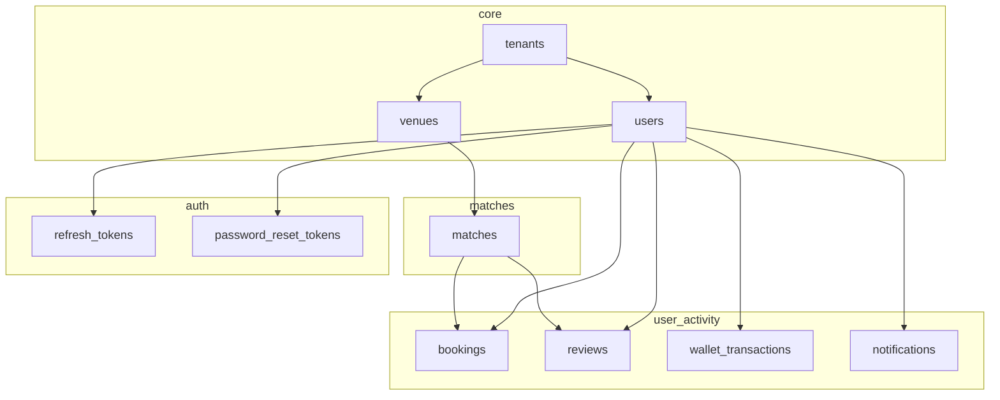

# SportBooker Database Migrations

Schema documentation and Entity Relationship Diagram for the SportBooker database.

---

## Migration Order

| # | File | Description |
|---|------|-------------|
| 001 | `001_create_enums.sql` | Enums: user_role, sport_type, match_status, booking_status, wallet_tx_type, notification_type, notification_channel |
| 002 | `002_create_tenants.sql` | Multi-tenant root table |
| 003 | `003_create_users.sql` | Users (tenant-scoped, soft delete, wallet) |
| 004 | `004_create_venues.sql` | Venues per tenant |
| 005 | `005_create_matches.sql` | Matches at venues |
| 006 | `006_create_bookings.sql` | User bookings for matches |
| 007 | `007_create_wallet_transactions.sql` | Wallet transaction history |
| 008 | `008_create_reviews.sql` | User reviews for matches |
| 009 | `009_create_notifications.sql` | User notifications |
| 010 | `010_create_refresh_tokens.sql` | JWT refresh token storage |
| 011 | `011_create_password_reset_tokens.sql` | Password reset token storage |

---

## Entity Relationship Diagram

```mermaid
erDiagram
    tenants ||--o{ users : "has"
    tenants ||--o{ venues : "has"
    venues ||--o{ matches : "hosts"
    matches ||--o{ bookings : "has"
    users ||--o{ bookings : "makes"
    users ||--o{ wallet_transactions : "has"
    matches ||--o{ reviews : "has"
    users ||--o{ reviews : "writes"
    users ||--o{ notifications : "receives"
    users ||--o{ refresh_tokens : "has"
    users ||--o{ password_reset_tokens : "has"

    tenants {
        uuid id PK
        varchar name
        timestamptz created_at
        timestamptz updated_at
    }

    users {
        uuid id PK
        uuid tenant_id FK
        varchar email
        varchar password_hash
        user_role role
        numeric wallet_balance
        timestamptz deleted_at
        timestamptz created_at
        timestamptz updated_at
    }

    venues {
        uuid id PK
        uuid tenant_id FK
        varchar name
        text address
        timestamptz created_at
        timestamptz updated_at
    }

    matches {
        uuid id PK# SportBooker Database Migrations

Schema documentation and Entity Relationship Diagram for the SportBooker database.

---

## Migration Order

| # | File | Description |
|---|------|-------------|
| 001 | `001_create_enums.sql` | Enums: user_role, sport_type, match_status, booking_status, wallet_tx_type, notification_type, notification_channel |
| 002 | `002_create_tenants.sql` | Multi-tenant root table |
| 003 | `003_create_users.sql` | Users (tenant-scoped, soft delete, wallet) |
| 004 | `004_create_venues.sql` | Venues per tenant |
| 005 | `005_create_matches.sql` | Matches at venues |
| 006 | `006_create_bookings.sql` | User bookings for matches |
| 007 | `007_create_wallet_transactions.sql` | Wallet transaction history |
| 008 | `008_create_reviews.sql` | User reviews for matches |
| 009 | `009_create_notifications.sql` | User notifications |
| 010 | `010_create_refresh_tokens.sql` | JWT refresh token storage |
| 011 | `011_create_password_reset_tokens.sql` | Password reset token storage |

---

## Entity Relationship Diagram

```mermaid
erDiagram
    tenants ||--o{ users : "has"
    tenants ||--o{ venues : "has"
    venues ||--o{ matches : "hosts"
    matches ||--o{ bookings : "has"
    users ||--o{ bookings : "makes"
    users ||--o{ wallet_transactions : "has"
    matches ||--o{ reviews : "has"
    users ||--o{ reviews : "writes"
    users ||--o{ notifications : "receives"
    users ||--o{ refresh_tokens : "has"
    users ||--o{ password_reset_tokens : "has"

    tenants {
        uuid id PK
        varchar name
        timestamptz created_at
        timestamptz updated_at
    }

    users {
        uuid id PK
        uuid tenant_id FK
        varchar email
        varchar password_hash
        user_role role
        numeric wallet_balance
        timestamptz deleted_at
        timestamptz created_at
        timestamptz updated_at
    }

    venues {
        uuid id PK
        uuid tenant_id FK
        varchar name
        text address
        timestamptz created_at
        timestamptz updated_at
    }

    matches {
        uuid id PK
        uuid venue_id FK
        sport_type sport_type
        timestamptz scheduled_at
        numeric price_per_player
        match_status status
        int max_players
        timestamptz created_at
        timestamptz updated_at
    }

    bookings {
        uuid id PK
        uuid match_id FK
        uuid user_id FK
        booking_status status
        timestamptz created_at
        timestamptz updated_at
    }

    wallet_transactions {
        uuid id PK
        uuid user_id FK
        numeric amount
        wallet_tx_type type
        uuid reference_id
        timestamptz created_at
        timestamptz updated_at
    }

    reviews {
        uuid id PK
        uuid match_id FK
        uuid user_id FK
        smallint rating
        text comment
        timestamptz created_at
        timestamptz updated_at
    }

    notifications {
        uuid id PK
        uuid user_id FK
        notification_type type
        notification_channel channel
        jsonb payload
        timestamptz read_at
        timestamptz created_at
        timestamptz updated_at
    }

    refresh_tokens {
        uuid id PK
        uuid user_id FK
        varchar token_hash
        timestamptz expires_at
        timestamptz created_at
        timestamptz updated_at
    }

    password_reset_tokens {
        uuid id PK
        uuid user_id FK
        varchar token_hash
        timestamptz expires_at
        timestamptz created_at
        timestamptz updated_at
    }
```

---

## Relationship Overview (Text)

```
tenants
  ├── users (1:N)          — tenant_id
  └── venues (1:N)         — tenant_id

venues
  └── matches (1:N)        — venue_id

matches
  ├── bookings (1:N)       — match_id
  └── reviews (1:N)        — match_id

users
  ├── bookings (1:N)       — user_id
  ├── wallet_transactions (1:N) — user_id
  ├── reviews (1:N)        — user_id
  ├── notifications (1:N) — user_id
  ├── refresh_tokens (1:N) — user_id
  └── password_reset_tokens (1:N) — user_id
```

---

## Table Details

### tenants
| Column | Type | Constraints |
|--------|------|-------------|
| id | UUID | PK, DEFAULT gen_random_uuid() |
| name | VARCHAR(255) | NOT NULL |
| created_at | TIMESTAMPTZ | NOT NULL, DEFAULT now() |
| updated_at | TIMESTAMPTZ | NOT NULL, DEFAULT now() |

---

### users
| Column | Type | Constraints |
|--------|------|-------------|
| id | UUID | PK, DEFAULT gen_random_uuid() |
| tenant_id | UUID | NOT NULL, FK → tenants(id) ON DELETE CASCADE |
| email | VARCHAR(255) | NOT NULL |
| password_hash | VARCHAR(255) | NOT NULL |
| role | user_role | NOT NULL |
| wallet_balance | NUMERIC(10,2) | NOT NULL, DEFAULT 0 |
| deleted_at | TIMESTAMPTZ | (soft delete) |
| created_at | TIMESTAMPTZ | NOT NULL, DEFAULT now() |
| updated_at | TIMESTAMPTZ | NOT NULL, DEFAULT now() |

**Indexes:** idx_users_tenant_id, idx_users_email, idx_users_deleted_at  
**Unique:** (tenant_id, email)

---

### venues
| Column | Type | Constraints |
|--------|------|-------------|
| id | UUID | PK, DEFAULT gen_random_uuid() |
| tenant_id | UUID | NOT NULL, FK → tenants(id) ON DELETE CASCADE |
| name | VARCHAR(255) | NOT NULL |
| address | TEXT | |
| created_at | TIMESTAMPTZ | NOT NULL, DEFAULT now() |
| updated_at | TIMESTAMPTZ | NOT NULL, DEFAULT now() |

**Indexes:** idx_venues_tenant_id

---

### matches
| Column | Type | Constraints |
|--------|------|-------------|
| id | UUID | PK, DEFAULT gen_random_uuid() |
| venue_id | UUID | NOT NULL, FK → venues(id) ON DELETE CASCADE |
| sport_type | sport_type | NOT NULL |
| scheduled_at | TIMESTAMPTZ | NOT NULL |
| price_per_player | NUMERIC(10,2) | NOT NULL |
| status | match_status | NOT NULL, DEFAULT 'scheduled' |
| max_players | INT | |
| created_at | TIMESTAMPTZ | NOT NULL, DEFAULT now() |
| updated_at | TIMESTAMPTZ | NOT NULL, DEFAULT now() |

**Indexes:** idx_matches_venue_id, idx_matches_scheduled_at, idx_matches_status

---

### bookings
| Column | Type | Constraints |
|--------|------|-------------|
| id | UUID | PK, DEFAULT gen_random_uuid() |
| match_id | UUID | NOT NULL, FK → matches(id) ON DELETE CASCADE |
| user_id | UUID | NOT NULL, FK → users(id) ON DELETE CASCADE |
| status | booking_status | NOT NULL, DEFAULT 'pending' |
| created_at | TIMESTAMPTZ | NOT NULL, DEFAULT now() |
| updated_at | TIMESTAMPTZ | NOT NULL, DEFAULT now() |

**Indexes:** idx_bookings_match_id, idx_bookings_user_id  
**Unique:** (match_id, user_id)

---

### wallet_transactions
| Column | Type | Constraints |
|--------|------|-------------|
| id | UUID | PK, DEFAULT gen_random_uuid() |
| user_id | UUID | NOT NULL, FK → users(id) ON DELETE CASCADE |
| amount | NUMERIC(10,2) | NOT NULL |
| type | wallet_tx_type | NOT NULL |
| reference_id | UUID | |
| created_at | TIMESTAMPTZ | NOT NULL, DEFAULT now() |
| updated_at | TIMESTAMPTZ | NOT NULL, DEFAULT now() |

**Indexes:** idx_wallet_transactions_user_id, idx_wallet_transactions_created_at

---

### reviews
| Column | Type | Constraints |
|--------|------|-------------|
| id | UUID | PK, DEFAULT gen_random_uuid() |
| match_id | UUID | NOT NULL, FK → matches(id) ON DELETE CASCADE |
| user_id | UUID | NOT NULL, FK → users(id) ON DELETE CASCADE |
| rating | SMALLINT | NOT NULL, CHECK (1–5) |
| comment | TEXT | |
| created_at | TIMESTAMPTZ | NOT NULL, DEFAULT now() |
| updated_at | TIMESTAMPTZ | NOT NULL, DEFAULT now() |

**Indexes:** idx_reviews_match_id, idx_reviews_user_id  
**Unique:** (match_id, user_id)

---

### notifications
| Column | Type | Constraints |
|--------|------|-------------|
| id | UUID | PK, DEFAULT gen_random_uuid() |
| user_id | UUID | NOT NULL, FK → users(id) ON DELETE CASCADE |
| type | notification_type | NOT NULL |
| channel | notification_channel | NOT NULL |
| payload | JSONB | |
| read_at | TIMESTAMPTZ | |
| created_at | TIMESTAMPTZ | NOT NULL, DEFAULT now() |
| updated_at | TIMESTAMPTZ | NOT NULL, DEFAULT now() |

**Indexes:** idx_notifications_user_id, idx_notifications_read_at

---

### refresh_tokens
| Column | Type | Constraints |
|--------|------|-------------|
| id | UUID | PK, DEFAULT gen_random_uuid() |
| user_id | UUID | NOT NULL, FK → users(id) ON DELETE CASCADE |
| token_hash | VARCHAR(255) | NOT NULL |
| expires_at | TIMESTAMPTZ | NOT NULL |
| created_at | TIMESTAMPTZ | NOT NULL, DEFAULT now() |
| updated_at | TIMESTAMPTZ | NOT NULL, DEFAULT now() |

**Indexes:** idx_refresh_tokens_user_id, idx_refresh_tokens_expires_at

---

### password_reset_tokens
| Column | Type | Constraints |
|--------|------|-------------|
| id | UUID | PK, DEFAULT gen_random_uuid() |
| user_id | UUID | NOT NULL, FK → users(id) ON DELETE CASCADE |
| token_hash | VARCHAR(255) | NOT NULL |
| expires_at | TIMESTAMPTZ | NOT NULL |
| created_at | TIMESTAMPTZ | NOT NULL, DEFAULT now() |
| updated_at | TIMESTAMPTZ | NOT NULL, DEFAULT now() |

**Indexes:** idx_password_reset_tokens_user_id, idx_password_reset_tokens_expires_at

---

## Enums

| Enum | Values |
|------|--------|
| user_role | admin, user, venue_owner |
| sport_type | football, basketball, tennis, volleyball, other |
| match_status | scheduled, in_progress, completed, cancelled |
| booking_status | pending, confirmed, cancelled |
| wallet_tx_type | credit, debit, refund |
| notification_type | booking, reminder, match_update, wallet |
| notification_channel | email, sms, push |

---

## Simplified ERD (Flowchart)



---

## Running Migrations

```bash
npm run migrate
```

Requires: `DB_HOST`, `DB_PORT`, `DB_NAME`, `DB_USER`, `DB_PASSWORD` in `.env`.

        uuid venue_id FK
        sport_type sport_type
        timestamptz scheduled_at
        numeric price_per_player
        match_status status
        int max_players
        timestamptz created_at
        timestamptz updated_at
    }

    bookings {
        uuid id PK
        uuid match_id FK
        uuid user_id FK
        booking_status status
        timestamptz created_at
        timestamptz updated_at
    }

    wallet_transactions {
        uuid id PK
        uuid user_id FK
        numeric amount
        wallet_tx_type type
        uuid reference_id
        timestamptz created_at
        timestamptz updated_at
    }

    reviews {
        uuid id PK
        uuid match_id FK
        uuid user_id FK
        smallint rating
        text comment
        timestamptz created_at
        timestamptz updated_at
    }

    notifications {
        uuid id PK
        uuid user_id FK
        notification_type type
        notification_channel channel
        jsonb payload
        timestamptz read_at
        timestamptz created_at
        timestamptz updated_at
    }

    refresh_tokens {
        uuid id PK
        uuid user_id FK
        varchar token_hash
        timestamptz expires_at
        timestamptz created_at
        timestamptz updated_at
    }

    password_reset_tokens {
        uuid id PK
        uuid user_id FK
        varchar token_hash
        timestamptz expires_at
        timestamptz created_at
        timestamptz updated_at
    }
```

---

## Relationship Overview (Text)

```
tenants
  ├── users (1:N)          — tenant_id
  └── venues (1:N)         — tenant_id

venues
  └── matches (1:N)        — venue_id

matches
  ├── bookings (1:N)       — match_id
  └── reviews (1:N)        — match_id

users
  ├── bookings (1:N)       — user_id
  ├── wallet_transactions (1:N) — user_id
  ├── reviews (1:N)        — user_id
  ├── notifications (1:N) — user_id
  ├── refresh_tokens (1:N) — user_id
  └── password_reset_tokens (1:N) — user_id
```

---

## Table Details

### tenants
| Column | Type | Constraints |
|--------|------|-------------|
| id | UUID | PK, DEFAULT gen_random_uuid() |
| name | VARCHAR(255) | NOT NULL |
| created_at | TIMESTAMPTZ | NOT NULL, DEFAULT now() |
| updated_at | TIMESTAMPTZ | NOT NULL, DEFAULT now() |

---

### users
| Column | Type | Constraints |
|--------|------|-------------|
| id | UUID | PK, DEFAULT gen_random_uuid() |
| tenant_id | UUID | NOT NULL, FK → tenants(id) ON DELETE CASCADE |
| email | VARCHAR(255) | NOT NULL |
| password_hash | VARCHAR(255) | NOT NULL |
| role | user_role | NOT NULL |
| wallet_balance | NUMERIC(10,2) | NOT NULL, DEFAULT 0 |
| deleted_at | TIMESTAMPTZ | (soft delete) |
| created_at | TIMESTAMPTZ | NOT NULL, DEFAULT now() |
| updated_at | TIMESTAMPTZ | NOT NULL, DEFAULT now() |

**Indexes:** idx_users_tenant_id, idx_users_email, idx_users_deleted_at  
**Unique:** (tenant_id, email)

---

### venues
| Column | Type | Constraints |
|--------|------|-------------|
| id | UUID | PK, DEFAULT gen_random_uuid() |
| tenant_id | UUID | NOT NULL, FK → tenants(id) ON DELETE CASCADE |
| name | VARCHAR(255) | NOT NULL |
| address | TEXT | |
| created_at | TIMESTAMPTZ | NOT NULL, DEFAULT now() |
| updated_at | TIMESTAMPTZ | NOT NULL, DEFAULT now() |

**Indexes:** idx_venues_tenant_id

---

### matches
| Column | Type | Constraints |
|--------|------|-------------|
| id | UUID | PK, DEFAULT gen_random_uuid() |
| venue_id | UUID | NOT NULL, FK → venues(id) ON DELETE CASCADE |
| sport_type | sport_type | NOT NULL |
| scheduled_at | TIMESTAMPTZ | NOT NULL |
| price_per_player | NUMERIC(10,2) | NOT NULL |
| status | match_status | NOT NULL, DEFAULT 'scheduled' |
| max_players | INT | |
| created_at | TIMESTAMPTZ | NOT NULL, DEFAULT now() |
| updated_at | TIMESTAMPTZ | NOT NULL, DEFAULT now() |

**Indexes:** idx_matches_venue_id, idx_matches_scheduled_at, idx_matches_status

---

### bookings
| Column | Type | Constraints |
|--------|------|-------------|
| id | UUID | PK, DEFAULT gen_random_uuid() |
| match_id | UUID | NOT NULL, FK → matches(id) ON DELETE CASCADE |
| user_id | UUID | NOT NULL, FK → users(id) ON DELETE CASCADE |
| status | booking_status | NOT NULL, DEFAULT 'pending' |
| created_at | TIMESTAMPTZ | NOT NULL, DEFAULT now() |
| updated_at | TIMESTAMPTZ | NOT NULL, DEFAULT now() |

**Indexes:** idx_bookings_match_id, idx_bookings_user_id  
**Unique:** (match_id, user_id)

---

### wallet_transactions
| Column | Type | Constraints |
|--------|------|-------------|
| id | UUID | PK, DEFAULT gen_random_uuid() |
| user_id | UUID | NOT NULL, FK → users(id) ON DELETE CASCADE |
| amount | NUMERIC(10,2) | NOT NULL |
| type | wallet_tx_type | NOT NULL |
| reference_id | UUID | |
| created_at | TIMESTAMPTZ | NOT NULL, DEFAULT now() |
| updated_at | TIMESTAMPTZ | NOT NULL, DEFAULT now() |

**Indexes:** idx_wallet_transactions_user_id, idx_wallet_transactions_created_at

---

### reviews
| Column | Type | Constraints |
|--------|------|-------------|
| id | UUID | PK, DEFAULT gen_random_uuid() |
| match_id | UUID | NOT NULL, FK → matches(id) ON DELETE CASCADE |
| user_id | UUID | NOT NULL, FK → users(id) ON DELETE CASCADE |
| rating | SMALLINT | NOT NULL, CHECK (1–5) |
| comment | TEXT | |
| created_at | TIMESTAMPTZ | NOT NULL, DEFAULT now() |
| updated_at | TIMESTAMPTZ | NOT NULL, DEFAULT now() |

**Indexes:** idx_reviews_match_id, idx_reviews_user_id  
**Unique:** (match_id, user_id)

---

### notifications
| Column | Type | Constraints |
|--------|------|-------------|
| id | UUID | PK, DEFAULT gen_random_uuid() |
| user_id | UUID | NOT NULL, FK → users(id) ON DELETE CASCADE |
| type | notification_type | NOT NULL |
| channel | notification_channel | NOT NULL |
| payload | JSONB | |
| read_at | TIMESTAMPTZ | |
| created_at | TIMESTAMPTZ | NOT NULL, DEFAULT now() |
| updated_at | TIMESTAMPTZ | NOT NULL, DEFAULT now() |

**Indexes:** idx_notifications_user_id, idx_notifications_read_at

---

### refresh_tokens
| Column | Type | Constraints |
|--------|------|-------------|
| id | UUID | PK, DEFAULT gen_random_uuid() |
| user_id | UUID | NOT NULL, FK → users(id) ON DELETE CASCADE |
| token_hash | VARCHAR(255) | NOT NULL |
| expires_at | TIMESTAMPTZ | NOT NULL |
| created_at | TIMESTAMPTZ | NOT NULL, DEFAULT now() |
| updated_at | TIMESTAMPTZ | NOT NULL, DEFAULT now() |

**Indexes:** idx_refresh_tokens_user_id, idx_refresh_tokens_expires_at

---

### password_reset_tokens
| Column | Type | Constraints |
|--------|------|-------------|
| id | UUID | PK, DEFAULT gen_random_uuid() |
| user_id | UUID | NOT NULL, FK → users(id) ON DELETE CASCADE |
| token_hash | VARCHAR(255) | NOT NULL |
| expires_at | TIMESTAMPTZ | NOT NULL |
| created_at | TIMESTAMPTZ | NOT NULL, DEFAULT now() |
| updated_at | TIMESTAMPTZ | NOT NULL, DEFAULT now() |

**Indexes:** idx_password_reset_tokens_user_id, idx_password_reset_tokens_expires_at

---


## Running Migrations

```bash
npm run migrate
```

Requires: `DB_HOST`, `DB_PORT`, `DB_NAME`, `DB_USER`, `DB_PASSWORD` in `.env`.
